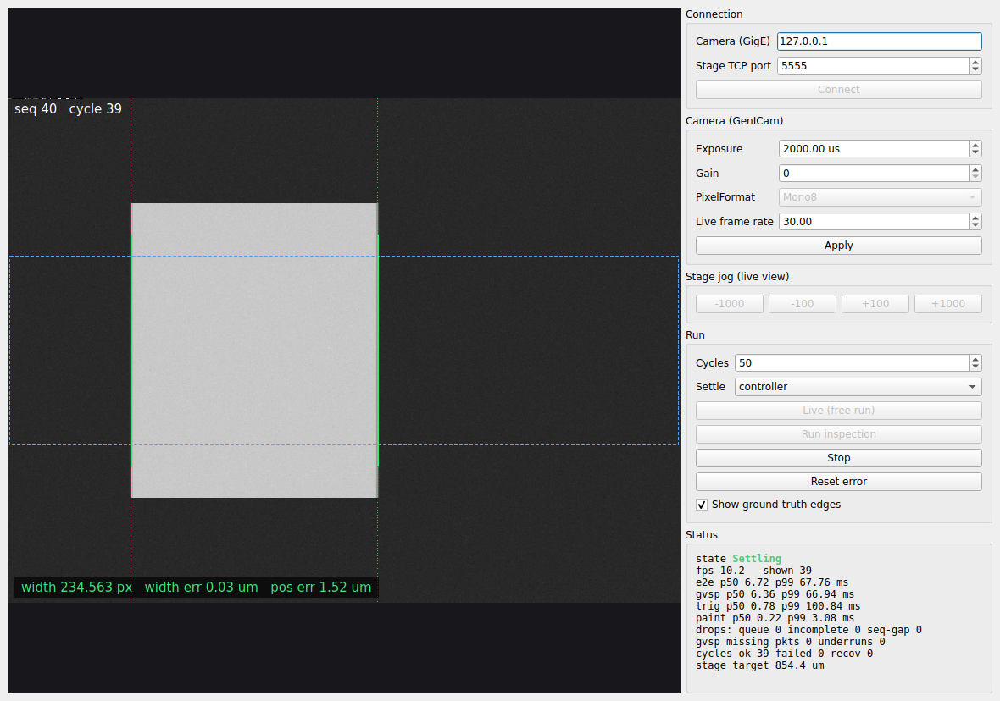

# vision-station

A Qt 6 C++ machine-vision station. It drives a GenICam camera over the **real GigE Vision protocol**
(Aravis: GVCP control, GVSP streaming over UDP) and a motion stage over a TCP command protocol. It runs
an inspection loop of move → settle → software trigger → acquire → sub-pixel measure, with timeouts and
error recovery, on a multithreaded pipeline that counts every dropped frame.

There's no camera or stage hardware. The camera is Aravis's fake GigE Vision camera, which speaks the
real protocols. I replaced its image generator so that each frame shows a machined part where the
simulated stage currently puts it, blurred by any stage motion during the exposure. The ground truth is
stamped into row 0 of the frame. **Every measurement below is scored against that truth.**



*Green lines are the measured sub-pixel edges, red dotted lines are the ground truth, and the blue box is the measurement band.
The screenshot is from `vs_station --smoke inspect` (offscreen Qt).*

## Processes and threads

```
vs_rig (process)                    vs_station (Qt) / vs_bench (headless)            vs_recorder (process)
  fake GigE camera  --GVCP/GVSP-->    Aravis GVSP rx thread
  stage controller  <--TCP 5555--     acquisition + sequencer thread                   POSIX shm ring
  (StageModel: trapezoid + ringing)     | BoundedQueue, drop-newest, every drop counted   (seqlock slots,
                                      processing thread (edges, scoring) --shm-->         overwrite-oldest)
                                        | coalesced queued signal (at most 1 in flight)
                                      Qt GUI thread
```

- **Camera**: features are resolved from the device's GenICam node map, not assumed. The fake camera has
  `ExposureTimeAbs` and `GainRaw`, not the SFNC names `ExposureTime` and `Gain`. See `vs_bench features`
  and [results/ci/features.md](results/ci/features.md).
- **Stage protocol** (ASCII lines, each with a deadline): `MOVE x` → `OK`, `ARRIVE t` → `ARRIVED`,
  `SETTLE t` → `DONE x`, `POS`, `RESET`, plus `FAULT stall|drop` for fault injection.
- **State machine**: Idle → Moving → Settling → Acquiring → Processing → Idle, and any active state →
  Error on Timeout/Fault, → Idle on Reset. It's table-driven, and
  [tests/test_uml_sync.cpp](tests/test_uml_sync.cpp) fails if
  [the PlantUML diagram](docs/uml/state_station.puml) and the C++ table ever disagree.

UML (PlantUML sources in [docs/uml](docs/uml), rendered in CI on every push):
[state](docs/uml/svg/state_station.svg) · [sequence of one cycle](docs/uml/svg/sequence_cycle.svg) ·
[class](docs/uml/svg/class.svg) · [use case](docs/uml/svg/use_case.svg)

## Results

All numbers come from GitHub Actions (ubuntu-24.04, 4 vCPU), in [results/ci/SUMMARY.md](results/ci/SUMMARY.md).
The image is 640×480 Mono8 at 10 µm/px, and the part is 2345.6 µm wide. Latency is measured from the end of exposure.

### Settling is what makes the measurement right (100 cycles each)

| settle policy | part position error, sd / max | frames exposed while the stage was out of position | cycle time p50 |
|---|---|---|---|
| wait for controller DONE | **1.63 / 2.02 µm** | 0 / 100 | 125 ms |
| fixed 20 ms delay | 9.33 / 16.51 µm | 87 / 100 | 85 ms |
| none (trigger on ARRIVED) | 12.90 / 25.69 µm | 99 / 100 | 65 ms |

With the controller handshake, the error matches the controller's ±2 µm in-position tolerance.

### Sub-pixel edges (controller settle, 100 cycles = 200 edges)

| peak fit | edge error max vs truth | part width error sd |
|---|---|---|
| Gaussian (parabola through ln gradient) | **0.011 px** | **0.068 µm** |
| parabolic | 0.044 px | 0.540 µm |
| integer pixel | 0.502 px | 4.96 µm |

### Pipeline: throughput, latency, drops (free run)

| run | processed fps | drops | latency p50 / p99 / max |
|---|---|---|---|
| 100 fps | 99.2 | 0 | 1.58 / 2.00 / 3.40 ms |
| 200 fps, processing 8 ms/frame, queue depth 8 | 124.2 | 741 queue drops (counted) | 71.4 / 74.1 / 74.3 ms |
| same, queue depth 2 | 123.6 | 738 queue drops (counted) | **23.3 / 25.9 / 26.0 ms** |

In every run `rx_complete == processed + queue_drops`, and the run fails if it doesn't balance. Under
overload the queue stays full, so queue depth × processing time becomes added latency. A short queue
gives the same throughput with a third of the latency.

### SCHED_FIFO vs normal scheduling (200 fps + 4 busy threads)

The simulated camera gets CPU 0 at SCHED_FIFO 90, standing in for hardware that doesn't share our CPUs,
so only the station's own threads change between runs.

| station threads | latency p50 / p99 / max | lost frames |
|---|---|---|
| SCHED_OTHER | 2.71 / 5.70 / 25.09 ms | 0 |
| **SCHED_FIFO 80 + pinned** | **2.32 / 2.37 / 2.72 ms** | 0 |
| SCHED_FIFO 80, not pinned | 2.32 / 2.36 / 2.69 ms | 0 |
| pinned only (SCHED_OTHER) | 4.68 / 4.68 / 6.68 ms | 0 |

FIFO is what helps: p99 drops 2.4× and max drops 9×. Pinning adds nothing on top of it, and pinning
without FIFO is worse, because pinned threads can't move off the busy CPUs. The FIFO setting reaches
Aravis's own GVSP receive thread through the stream's `INIT` callback, which runs on that thread.

### GigE Vision transport findings

- **GVSP frame loss came from a socket default.** By default Aravis doesn't set `SO_RCVBUF`, so the
  kernel's `rmem_default` applies. On WSL2 that's 208 KB, smaller than one 300 KB frame. The default
  lost 438 of 735 and 119 of 138 frames in two 10 s runs. With `socket-buffer=AUTO`, 4 of 755 and
  0 of 818 were lost ([results/local](results/local/SUMMARY.md)). On the CI runner neither setting
  lost frames, even with `rmem_default` forced to 208 KB: loss also needs a receiver that falls
  behind during the burst. The station always sizes the buffer to the frame.
- **Running as root silently changes how frames are received.** With CAP_NET_RAW, Aravis switches GVSP
  reception to a `PF_PACKET` TPACKET_V3 ring with a 5 ms block-retire timeout. At the same scheduling
  that cost 6.02 vs 2.71 ms at p50 (`root_other_*` in results/ci). The station disables it by default
  (`StreamOptions::packet_socket`), so root and non-root runs measure the same thing. My first
  SCHED_FIFO numbers were confounded by exactly this, because they were the only runs under sudo.
- **Trigger latency on the fake camera is a polling artefact.** It checks for a pending software trigger
  once per `1/trigger_frequency` (default 25 Hz, so up to 40 ms). The rig sets 1 kHz, giving
  trigger→exposure of 0.56 / 1.05 ms (p50 / p99). That's a property of the simulator, not of GVCP.

### Recovery, IPC, calibration

- **Fault injection** (stall at 3 cycles, dropped TCP connection): 27 cycles ok, 3 failed, 3 recovered
  (reconnect, RESET, re-read POS), and the plan continued. Position error stayed within 2.06 µm.
- **Shared-memory recorder** at 200 fps: 1583 of 1583 frames read, 0.12 / 0.36 ms publish→read. A
  deliberately slow recorder (10 ms/frame) read 852 and counted exactly 739 overrun frames:
  852 + 739 = 1591 published. The station never waited.
- **Calibration** (Zhang / OpenCV on 20 synthetic checkerboard views with known intrinsics, 5 held
  out): RMS reprojection 0.076 px on training views and 0.071 px on held-out views. fx and fy within
  0.05%. Detected corners averaged 0.062 px from the true projections. With k3 free, k2 and k3 trade off
  (k2 −0.047 vs a true 0.09) at the same RMS, so k3 is fixed by default (k2 then comes out at 0.076).

## Build and run (Linux)

```bash
sudo apt install build-essential cmake ninja-build pkg-config libaravis-dev libusb-1.0-0-dev \
  libxml2-dev zlib1g-dev qt6-base-dev libgl-dev libopencv-dev libgtest-dev
cmake -S . -B build -G Ninja && cmake --build build
ctest --test-dir build                 # 34 unit tests
build/vs_rig &                         # fake GigE camera + stage controller
build/vs_station                       # GUI: Connect, Live, Run inspection
bash scripts/e2e.sh build              # end-to-end against the fake camera
bash scripts/bench_all.sh build out    # every number above (--sudo for the RT runs)
```

On Windows (MSYS2 UCRT64), CI builds the core, camera, pipeline, GUI and tests and runs the unit tests.
The rig and the shared-memory recorder are Linux-only.

CI ([.github/workflows/ci.yml](.github/workflows/ci.yml)) runs four jobs:
- **Linux:** Release build, unit tests, e2e and benchmarks.
- **Sanitizers:** ASan + UBSan on the unit tests (leak checks on) and the e2e.
- **UML:** renders the PlantUML diagrams.
- **Windows:** the MSYS2 build and unit tests.

## Limits (read before quoting)

- No real camera or stage. The protocols are real (GVCP/GVSP over loopback UDP, TCP to the stage), but
  the scene and the stage dynamics are simulated. That's why ground truth exists.
- Loopback, not a NIC, so there's no story about NIC ring size, interrupt coalescing or jumbo frames.
- 1-axis stage, Mono8 only in the rig, a single rectangular part.
- Calibration has only been validated on synthetic images.
- `apps/rig` relies on one hack: it mirrors Aravis 0.8.30's private `ArvBufferPrivate` to set
  `received_size`, because the fake camera's fill hook offers no public setter. It's checked at
  startup and guarded at compile time.
- Licences: Aravis (LGPL-2.1+) and Qt (LGPL-3) are linked dynamically, and OpenCV is Apache-2.0.
  Nothing from them is redistributed in this repo.
